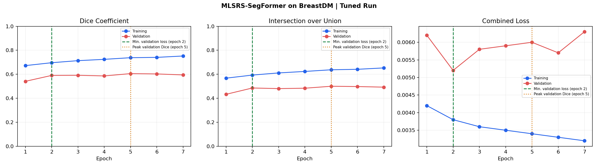
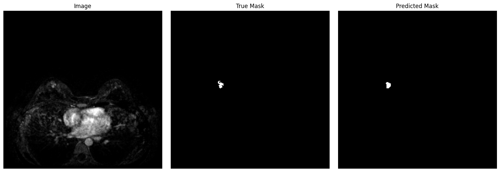
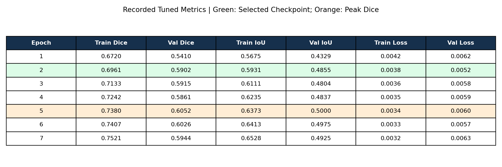

# BreastDM Lesion Segmentation with MLSRS-SegFormer

An artificial intelligence project by **Mehmet Mikail Karaman**, exploring pixel-level breast lesion segmentation using the **BreastDM** dataset and a custom **TensorFlow/Keras MLSRS-SegFormer implementation**.

I implemented an image–mask preprocessing pipeline, trained a hierarchical transformer segmentation model, explored hyperparameter tuning, and visualized predicted masks alongside reference annotations. The task uses binary foreground/background masks; it does not classify lesions as benign or malignant.

## Dataset and preprocessing

The saved notebook reports the following image–mask pair counts. These are image counts, not patient counts.

| Split | Images | Masks |
| --- | ---: | ---: |
| Training | 20,434 | 20,434 |
| Validation | 1,989 | 1,989 |
| Test | 7,089 | 7,089 |
| Total | 29,512 | 29,512 |

Resize images and masks to **256 × 256**; normalize image intensities to [0, 1]. Resize masks with nearest-neighbor interpolation, threshold at 127, and one-hot encode two classes.

Apply random horizontal/vertical flips, brightness changes, and contrast changes to training data. Use a `tf.data` pipeline with batch size **4**, parallel mapping, and prefetching.

## Model and training

The implementation contains four encoder stages with embedding dimensions **32, 64, 160, 256**, attention head counts **1, 2, 5, 8**, and two transformer blocks per stage. Multi-scale features are projected to 128 channels and fused before upsampling to a two-class softmax mask.

Key components include learnable channel weights broadcast over patch tokens, normalized Euclidean spatial-distance attention bias, learnable 2D relative positional bias, and a MixFFN with depthwise convolution. The notebook calls the spatial component “Hausdorff bias”; its implementation uses pairwise Euclidean token distances. Fidelity to the original paper has not been independently checked.

Training uses **Adam**, gradient clipping (`clipnorm=1.0`), and **categorical cross-entropy + Dice loss**. Keras Tuner performs Bayesian optimization with three trials and up to three epochs per trial. The selected learning rate is **1e-4**. The subsequent tuned training run records seven epochs before early stopping, with checkpoint selection based on validation loss.

## Recorded results

These are **validation metrics from saved notebook outputs**, not held-out test scores. The tuned epoch numbers refer to training after the tuner search.

| Run / selection | Epoch | Validation Dice | Validation IoU | Validation loss |
| --- | ---: | ---: | ---: | ---: |
| Baseline, best Dice in the notebook's manually assembled 20-epoch history | 16 | 0.5658 | 0.4642 | 0.0084 |
| Tuned, checkpoint selected by minimum validation loss | 2 | 0.5902 | 0.4855 | 0.0052 |
| Tuned, highest observed validation Dice | 5 | **0.6052** | **0.5000** | 0.0060 |

The tuned run's peak validation Dice is **0.0394 higher** than the baseline's reported peak. This is an observed comparison, not a controlled ablation or evidence of statistical significance. The epoch-5 peak is different from the epoch-2 checkpoint used for the tuned predictions after reloading the best weights.



### Example segmentation

Left: input image. Center: reference mask. Right: predicted mask from the tuned model on a validation sample. This is one illustrative sample, not an aggregate measure of performance.



## Evaluation and reproducibility notes

The notebook generates predictions for 7,089 test images, but does not provide a saved aggregate test Dice/IoU evaluation. No test score is claimed here. Saved directory-inspection output lists `BreaDM-Be-1801/SUB1/p-032.jpg` in both training and test. Check patient identifiers, image hashes, and split construction before treating test evaluation as independent. The data itself was not supplied for this audit.

Images and masks are paired by independently sorting file paths. Verify matching relative paths before further experiments. Dice and IoU functions aggregate foreground pixels within each batch; they are not explicitly per-patient or per-image averages. Pixel accuracy is therefore not presented as the headline result.

The notebook's function named `compute_hd95` multiplies maximum symmetric Hausdorff distance by 0.95; it does not calculate a 95th-percentile surface distance. Its empty-mask handling also returns zero. Those numbers are excluded from the reported results. The tuner declares `expand_ratio`, but does not pass it into the model blocks. Only learning rate is demonstrably applied as a tuned setting.

The supplied notebook contains state-dependent cell ordering and a manually assembled baseline history. Its calculations and cell order are preserved in the translated edition; it is not a verified clean-run pipeline.

## Files and use

[`breastdm_mlsrs_segformer.ipynb`](breastdm_mlsrs_segformer.ipynb): English edition of the experiment notebook; outputs cleared to remove untranslated figures. [`tuned_metrics.csv`](tuned_metrics.csv): seven epochs transcribed programmatically from saved training logs, at their displayed precision.

Figures: English training figures regenerated from recorded logs and a validation example extracted unchanged from the notebook.

The original experiment uses a Kaggle dataset path stored in `ROOT`. Reproduction requires the BreastDM images and masks, access to the dataset under its applicable terms, the recorded custom layer definitions, and TensorFlow/Keras, NumPy, Matplotlib, SciPy, and Keras Tuner. Exact package versions, trained weights, and random seeds were not supplied. Training was not rerun while preparing this project presentation.

**Focus:** medical image segmentation · computer vision · transformers · deep learning · hyperparameter tuning

## Local setup

```bash
python -m venv .venv
source .venv/bin/activate
pip install -r requirements.txt
jupyter lab breastdm_mlsrs_segformer.ipynb
```

Update `ROOT` to your dataset location. Reorder dependent experiment cells before attempting a full run. The Python module files provides the extracted model, dataset pipeline, and metrics without starting training on import. These modules passed Python syntax checks; TensorFlow training was not rerun.

### Recorded epoch metrics



The accompanying `tuned_training_log.txt` retains the saved tuner/training text in English. No dataset or trained weights are bundled.
